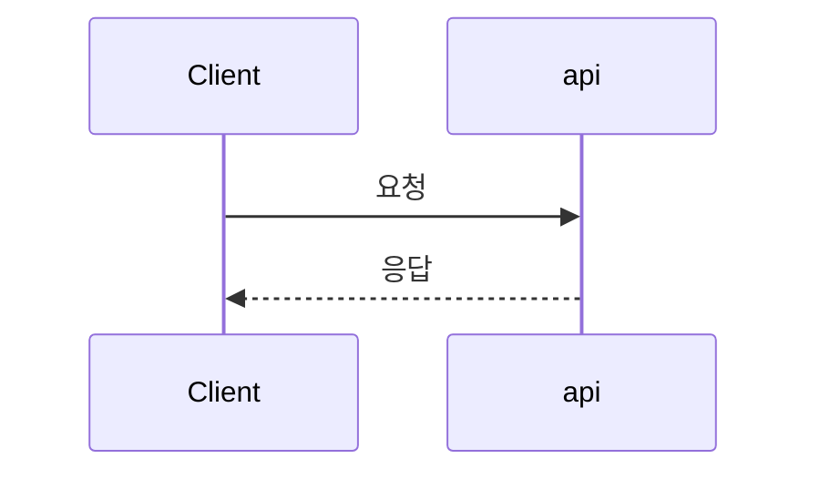

# <flow>

> 언제 시작해서 무엇으로 끝나는 흐름인가.

## 참여 개체

| 개체 | 역할 | 사양 |
| --- | --- | --- |

## 흐름

## 규칙 · 불변조건

- **R1** — WHEN <조건> THEN <결과>.

## 예외 케이스

| 케이스 | 동작 | 근거 |
| --- | --- | --- |

## 근거

- 
