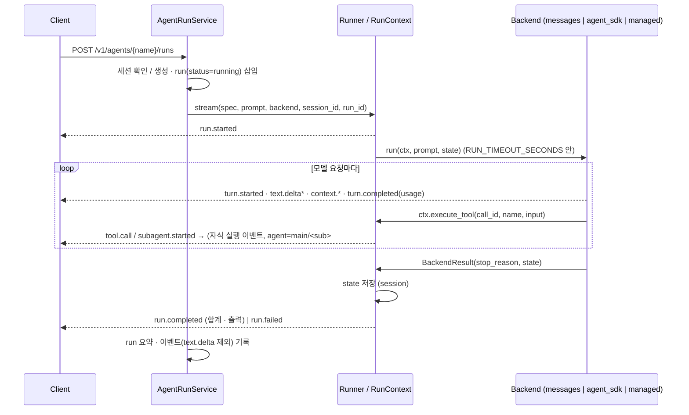

# 에이전트 실행 — 이벤트 계약과 백엔드 매핑

> 한 `AgentSpec` 을 세 백엔드 중 하나로 돌려 **같은 이벤트 스트림**을 낸다. 클라이언트 · 저장 · 로그 · trace 는 백엔드를 모른다.

## 참여 개체

| 개체 | 역할 | 사양 |
| --- | --- | --- |
| agents (앱) | HTTP · 세션 / 실행 기록 · SSE | [modules/agents.md](../modules/agents.md) |
| agent-core | 이벤트 계약 · Runner · 도구 실행 · 관측 · 백엔드 3종 | [packages/agent-core.md](../packages/agent-core.md) |

## 흐름

## 이벤트 계약 (`agent_core/events.py`)

모든 이벤트 공통: `run_id` · `seq`(1부터 연속) · `ts`(epoch 초) · `agent`(`main`, 서브에이전트는 `main/<name>#<위임 call_id>` — 같은 서브에이전트를 병렬로 불러도 구분된다). SSE = `event: <type>` · `id: <seq>` · `data: <JSON>`.

| type | 필드 | 낼 때 |
| --- | --- | --- |
| `run.started` | `backend` · `model` · `session_id` | 실행 시작 (항상 첫 이벤트) |
| `turn.started` | `turn` (에이전트별 1부터) · `model` | 모델 요청 1회 시작 |
| `text.delta` | `text` | 모델 텍스트 조각 |
| `turn.completed` | `turn` · `stop_reason` · `usage` | 모델 요청 1회 끝 |
| `tool.call` / `tool.result` | `call_id` · `name` · `input` / `output` · `is_error` · `duration_ms` | 도구 실행 전 / 후 |
| `subagent.started` / `subagent.completed` | `call_id` · `name` · `task` / `output` · `is_error` · `duration_ms` | 위임 도구 실행 전 / 후 |
| `context.compacted` | `pre_tokens` (없으면 null) | 대화 압축됨 |
| `context.edited` | `cleared_tool_uses` · `cleared_input_tokens` | 오래된 도구 결과 지워짐 (Messages 만) |
| `run.completed` | `session_id` · `stop_reason` · `output` · `turns` · `usage` · `duration_ms` | 정상 종료 (마지막) |
| `run.failed` | `code` · `message` | 실패 종료 (마지막) |

- `usage` = `{input_tokens, output_tokens, cache_read_tokens, cache_write_tokens, context_tokens}`. `context_tokens` = 입력 + 캐시 읽기 + 캐시 쓰기 = 그 요청에서 모델이 본 prompt 크기.
- `run.completed.usage` · `turns` = 모든 에이전트(서브에이전트 포함)의 `turn.completed` 합. `output` = main 의 **마지막 턴** 텍스트.
- `stop_reason` (run) = `end_turn` · `max_turns` · `refusal` · `budget` · `cancelled`. `turn.completed.stop_reason` 은 모델 값 그대로 (`end_turn` · `tool_use` · `max_tokens` …, Managed 는 다음 이벤트로 추정).
- 순서 보장: 한 턴 안에서 `turn.started` → `text.delta*` → `turn.completed` → 그 턴의 `tool.call`. 같은 턴의 도구 여러 개는 동시에 실행될 수 있어 `tool.call` / `tool.result` 가 섞일 수 있다 (`call_id` 로 짝).

## 백엔드 매핑

| 항목 | Messages API (`messages`) | Claude Agent SDK (`agent_sdk`) | Claude Managed Agents (`managed`) |
| --- | --- | --- | --- |
| 루프 위치 | 이 프로세스 (`MessagesBackend.run`) | 번들 Claude Code CLI (서브프로세스) | Anthropic 서버 세션 |
| turn 경계 | 요청 1회 (`messages.stream`) | `StreamEvent` `message_start` / `message_stop` (`include_partial_messages`) | `span.model_request_start` / `span.model_request_end` |
| text.delta | `text_stream` 조각 | `content_block_delta` `text_delta` | `agent.message` (요청 하나의 텍스트 통째) |
| usage | `message.usage` | `message_start.usage` + `message_delta.usage` | `model_request_end.model_usage` |
| 도구 호출 | 응답의 `tool_use` → `execute_tool` → `tool_result` (한 턴의 호출은 동시) | in-process MCP(`mcp__app__<name>`) handler → `execute_tool`. `call_id` = 스트림의 `tool_use.id` (이름 + 인자로 대조). 전 도구 `readOnlyHint` → CLI 도 동시 실행 | `agent.custom_tool_use` → `execute_tool` → `user.custom_tool_result` (동시) |
| 내장 도구 | 없음 | `tools=[]` 로 전부 끔 | `agent_toolset` 미등록 |
| system prompt · 격리 | `system` (캐시 breakpoint) | `system_prompt=<문자열>` (Claude Code prompt 대체) · `setting_sources=[]` · `strict_mcp_config` · `verbatim_prompts` (입력의 `@경로` · `/명령` 을 해석하지 않음) | agent `system` |
| 압축 | `compact_20260112` (임계 = `compact_at_tokens`) → `compaction` 블록 | CLI 자체 (`compact_boundary`) | 서버 자체 (`agent.thread_context_compacted`) |
| 도구 결과 지우기 | `clear_tool_uses_20250919` (`clear_tool_uses_at_tokens`) → `applied_edits` | 없음 | 없음 |
| max_turns | 루프 상한 → `max_turns` | `max_turns` 옵션 → `error_max_turns` | 다음 요청 시작 시 `user.interrupt` → `max_turns` |
| API 실패 | `AnthropicError` → `UPSTREAM_*` | `ResultMessage.is_error` + `api_error_status` (429 · 5xx · 기타) → `UPSTREAM_*` | API 오류 → `UPSTREAM_*`, `session.error` (재시도 아님) → `UPSTREAM_ERROR` |
| session state | `{messages: [...]}` 전체 이력 | `{sdk_session_id}` (`resume` — 시작 전 로컬 transcript 확인, 없으면 `SESSION_STATE_LOST`) | `{managed_session_id}` |
| 끊김 · 실패 시 | 요청 취소 | CLI 종료 | `user.interrupt` 전송 |

## 규칙 · 불변조건

- **R1** — 백엔드는 이벤트를 `ctx.emit` 으로만, 도구는 `ctx.execute_tool` 로만 다룬다. 봉투(`run_id` · `seq` · `ts`) · 합계 · 출력은 Runner 가 채운다.
- **R2** — 도구 실패(미등록 · 입력 검증 · timeout · 예외 · 문자열 아닌 반환)는 `is_error: true` 결과로 모델에 돌아가고 실행은 계속된다. 입력은 **strict JSON** 으로 검증한다 (`"5"` 는 int 아님 — Agent SDK 의 JSON Schema 검사와 같은 판정). 정수인 float(`5.0`)는 먼저 `5` 로 바꾼다 (SDK CLI 의 JavaScript 직렬화와 같게). 결과는 `ContextPolicy.tool_result_max_chars` 에서 잘리고 `[truncated: N more characters omitted]` 가 붙는다.
- **R3** — 서브에이전트 = `delegate_to_<name>` 도구 ([ADR-0006](../../adr/0006-subagent-as-delegate-tool.md)). 자식은 같은 백엔드로 빈 context 에서 돌고, 결과 = 자식 마지막 턴 텍스트. `end_turn` 이 아니면 `[subagent stopped early: <reason>]` 를 덧붙인다. 자식의 `BackendError` 는 도구 오류가 아니라 **run 실패**다 (세 백엔드 모두, `subagent.completed` 없이 `run.failed`).
- **R3a** — 한 턴의 도구 · 위임은 동시에 돌고, 하나가 `BackendError` 로 실패하면 나머지는 취소된다 (`gather_all`, Managed 는 응답 task 취소 + `user.interrupt`). run 이 끝난 뒤 남는 작업은 없다.
- **R4** — 실행 전체(서브에이전트 포함)는 `Runner.run_timeout_s` 안에서 끝난다. 넘으면 `run.failed` `RUN_TIMEOUT`, 세션 state 는 이전 값 유지.
- **R4a** — 스트림 소비자가 사라지면(클라이언트 끊김) 실행을 한 번 취소하고 백엔드 정리(CLI 종료 · 스트림 닫기 · `user.interrupt`)가 끝나길 최대 `CLEANUP_TIMEOUT_S`(30초) 기다린다 — anyio 의 반복 취소가 정리를 끊지 않는다.
- **R5** — 실패 · timeout 이면 세션 state 를 저장하지 않는다. Messages 는 다음 실행이 마지막 성공 이력에서 이어진다. Agent SDK · Managed 는 state(세션 id)가 그대로라 **실패한 교환이 원격 transcript 에 남아** 다음 실행의 모델이 그것을 본다 (원격 이력은 되돌릴 수 없다).
- **R6** — 로그 · trace 는 이벤트에서만 만든다 (`Observer`). 로그 필드 = 타입 · id · 이름 · usage · 소요 시간 — prompt · 출력 · 도구 입력 / 출력 본문은 남기지 않는다. OTel span = `invoke_agent {agent}` › `chat {model}` · `execute_tool {name}` · `invoke_agent {subagent}` (GenAI semconv, 이벤트 시각 기준).

## 예외 케이스

| 케이스 | 동작 | 근거 |
| --- | --- | --- |
| 도구 미등록 · 입력 필드 오류 · timeout · 예외 | `tool.result` `is_error: true`, 실행 계속 | `test_runtime.py::test_tool_failures_return_error_results_and_the_run_continues` |
| 서브에이전트 출력도 부모 `tool_result_max_chars` 로 잘림 | 위임 결과 = 잘린 텍스트 | `RunContext.execute_tool` |
| 백엔드 `BackendError` | `run.failed` + 그 `code` / `message` | `test_runtime.py::test_backend_failure_ends_with_run_failed` |
| 백엔드 예상 밖 예외 | `run.failed` `AGENT_RUN_FAILED` (내부 사유는 로그만) | 같은 테스트 |
| 실행이 `max_turns` 에서 끊김 → 다음 실행 | Messages: 마지막 user(tool_result) 메시지에 새 prompt 를 합친다 | `test_backends.py::test_new_prompt_merges_into_trailing_tool_results` |
| Agent SDK 도구 handler 가 `tool_use` 를 30초 안에 못 찾음 | `call_id` = `sdk_<uuid>` 로 실행 (경고 로그) | `CallIds.claim` |
| 같은 서브에이전트 병렬 위임 | 자식마다 다른 `agent` 경로 | `test_runtime.py::test_parallel_delegations_to_one_subagent_get_distinct_agent_paths` |
| 병렬 도구 중 하나가 `BackendError` | 형제 취소, `run.failed` | `test_runtime.py::test_gather_all_cancels_siblings_when_one_fails` |
| int 필드에 `"3"` (중첩 모델 포함) | `is_error` (strict JSON) | `test_runtime.py::test_tool_input_is_strict_json_like_the_agent_sdk_schema_check` |
| Agent SDK 결과 `success` + `is_error` (429 · 529 · 401) | `run.failed` `UPSTREAM_RATE_LIMITED` · `UPSTREAM_UNAVAILABLE` · `UPSTREAM_ERROR` | `test_backends.py::test_sdk_api_failures_reported_as_success_fail_the_run` |
| Agent SDK 세션의 로컬 transcript 없음 (다른 인스턴스 · 재배포) | CLI 를 띄우기 전 `run.failed` `SESSION_STATE_LOST` → 클라이언트는 새 세션. 일시적 기동 실패는 `UPSTREAM_UNAVAILABLE` | `test_backends.py::test_sdk_session_without_a_local_transcript_fails_before_starting_the_cli` |
| 클라이언트 끊김 (anyio 취소) | 백엔드 정리가 끝까지 돈다 | `test_runtime.py::test_closing_the_stream_under_anyio_lets_backend_cleanup_finish` |
| Managed 스트림을 열 때 지난 실행의 `status_idle` 이 먼저 옴 | `status_running` · 첫 요청 전 idle 은 무시 | `test_backends.py::test_managed_turn_end_waits_for_late_text_and_takes_the_tool_use_reason` |
| Managed `agent.message` 가 `model_request_end` 뒤에 옴 | `turn.completed` 를 다음 경계(도구 호출 · 다음 요청 · idle)까지 미뤄 텍스트가 그 턴에 들어간다 | 같은 테스트 |

## 알려진 한계

- **Managed** 의 `text.delta` 는 요청 단위 통째 (`event_deltas` preview 미사용). `context.compacted.pre_tokens` 는 항상 null.
- **Agent SDK** 세션 transcript 는 CLI 설정 디렉터리(`$HOME/.claude`, 이미지에선 컨테이너 FS)에 남는다 → 세션은 만든 인스턴스 · 컨테이너 수명 안에서만 이어지고, 그 밖에서는 `SESSION_STATE_LOST`. 영속화(`ClaudeAgentOptions.session_store` 또는 볼륨)는 [백로그](../../../agent-work/2611-template-bootstrap/README.md#백로그). SDK 가 입력 스키마 검증에 실패한 호출은 handler 에 오지 않아 `tool.call` / `tool.result` 이벤트가 없다 (판정은 R2 와 같고 오류 문구만 다르다).
- **Managed** 서버 재시도 시 `span.model_request_*` 가 시도마다 오면 turn 으로 세어진다 (확인 전). 서버 자체 도구 사용 한도(`tool_use_limit_reached_error`)는 `max_turns` 가 아니라 `UPSTREAM_ERROR`. 끊긴 직후 같은 세션 재요청은 앞선 interrupt 와 겹칠 수 있다.
- 압축 임계값 · 도구 결과 지우기는 Messages 만 적용된다 (나머지는 이벤트만 같다).
- 끊긴 run 은 백엔드 정리보다 먼저 `cancelled` 로 기록될 수 있다 (sse-starlette 가 쓰기 대기 중 취소될 때, 또는 위임 중 끊김으로 정리가 30초를 넘을 때). 그 사이 같은 세션 새 요청이 받아들여지면, Agent SDK 는 이전 CLI 와 같은 transcript 를 잠시 함께 쓸 수 있다 (손상 여부 미확인).
- `set` 필드의 중복 항목은 Agent SDK(JSON Schema `uniqueItems`)만 거부한다. 도구 입력에 `set` 대신 `list` 를 쓴다.
- 백엔드 실행이 성공한 뒤 state 저장 중(ms 단위) 끊기면 run 은 `cancelled` 로 기록되지만 state 는 저장된다 — 다음 실행이 사용자가 못 본 답을 이력에 가진다.
- Agent SDK 는 CLI 의 MCP 결과 크기 한도(기본 10만 자 · `MAX_MCP_OUTPUT_TOKENS`)가 있다 — `tool_result_max_chars` 를 그 아래로 둔다.
- 위임마다 SDK = CLI 프로세스 1개, Managed = 세션 1개가 더 생긴다.
- 백엔드 루프(네트워크 · 스트림 수명)는 자동 테스트 밖이다 ([ADR-0004](../../adr/0004-minimal-tests.md)). 실제 키로 수동 스모크: `AGENT_BACKEND=<backend>` 로 `POST /v1/agents/assistant/runs` 를 세 백엔드에 같은 입력으로 보내 이벤트 타입 순서 · `run.completed` 필드를 비교.

## 근거

- `packages/agent-core/src/agent_core/{events,runtime,context,observe}.py`
- `packages/agent-core/src/agent_core/backends/{messages,agent_sdk,managed}.py`
- `apps/api/src/api/modules/agents/service.py`
- `packages/agent-core/tests/test_{runtime,backends}.py` · `apps/api/tests/test_agent_runs.py`
